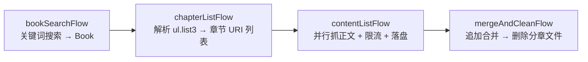

# spider4g

> 基于 **Groovy 6** 异步编程能力（`Awaitable` / `async` / `await`）的爬虫与任务编排框架。

`spider4g` 把「发请求 → 解析 → 转换 → 落盘」拆成一个个可复用的 `Task`，再用操作符像管道一样把任务串成 `Flow`，并以列表并行的方式批量执行，同时内置**重试、限流、延迟、并行**等爬虫场景里最常用的控制能力。

仓库附带一个可运行的完整示例：抓取 [quanben.io](https://www.quanben.io) 的全本小说（搜索 → 章节列表 → 章节正文 → 合并成单文件）。

---

## 目录

- [特性](#特性)
- [技术栈](#技术栈)
- [项目结构](#项目结构)
- [环境要求](#环境要求)
- [快速开始](#快速开始)
- [核心概念](#核心概念)
  - [Task：异步任务](#task异步任务)
  - [Flow：同步流程](#flow同步流程)
- [内置任务工厂](#内置任务工厂)
- [组合与并发控制](#组合与并发控制)
- [完整示例：全本小说下载](#完整示例全本小说下载)
- [如何扩展](#如何扩展)
- [测试](#测试)
- [注意事项与已知问题](#注意事项与已知问题)
- [许可证](#许可证)

---

## 特性

| 能力 | 说明 |
| --- | --- |
| **任务即函数** | `Task<T, R>` 继承 `Function<T, Awaitable<R>>`，因此任何 `{ t -> ... }` 闭包都能隐式转换为任务（Groovy SAM 转换），写法极简。 |
| **操作符编排** | `\|` 与 `>>` 重载为顺序组合，把 `A \| B \| C` 读成 shell 管道。 |
| **同步 / 异步双入口** | `Task` 返回 `Awaitable`（异步，需 `await` 取结果）；`Flow` 内部已 `await`，直接调用即阻塞拿值。 |
| **列表并行** | `withParallel` 把一个 `List<T>` 拆成 N 个任务并发执行，再统一收集结果。 |
| **限流** | `withRateLimit` + 全局 `Semaphore`（3 个许可）限制并发，并为每次执行附加固定延迟。 |
| **重试** | `retry` 在失败后延迟重试，支持多层递进延迟。 |
| **开箱即用的工厂** | HTTP（Groovy `HttpBuilder`）、HTML（jsoup）、JSON（`JsonSlurper`）、文件读写。 |
| **真实示例** | `Example4QuanBen` 演示真实站点的端到端抓取流水线。 |

---

## 技术栈

| 组件 | 版本 | 用途 |
| --- | --- | --- |
| [Apache Groovy](https://groovy-lang.org/) | 6.0.0 | 语言本体；`groovy.concurrent.Awaitable`、`groovy.http` 异步 HTTP |
| [Gradle](https://gradle.org/) | 9.8.2 | 构建（Wrapper 已内置） |
| [JUnit Jupiter](https://junit.org/junit5/) | 6.1.3 | 单元测试（经 `junit-bom` 统一版本） |
| [jsoup](https://jsoup.org/) | 1.23.2 | HTML 选择器解析 |
| [Log4j 2](https://logging.apache.org/log4j/2.x/) | 2.26.1 | 日志门面 + 实现（含 SLF4J 绑定） |

> `lib/` 目录存放 Groovy 6.0.0 的运行时与 `-sources` jar，仅作本地参考/IDE 附加源码使用；构建依赖仍由 `build.gradle` 从 Maven Central 解析。

---

## 项目结构

```
spider4g/
├── build.gradle                     # 依赖、编码与 JUnit Platform 配置
├── settings.gradle                  # rootProject.name = 'spider4g'
├── gradlew / gradlew.bat            # Gradle Wrapper 启动脚本
├── gradle/wrapper/                  # Wrapper 配置（Gradle 9.8.2）
├── lib/                             # Groovy 6.0.0 运行时 / 源码 jar（本地参考）
└── src/
    ├── main/
    │   ├── groovy/io/github/thetaoofcoding/
    │   │   ├── component/
    │   │   │   ├── Task.groovy      # 异步任务抽象（组合、重试、限流、并行）
    │   │   │   └── Flow.groovy      # 同步流程抽象（Task 的同步外壳）
    │   │   ├── factory/
    │   │   │   ├── HttpTasks.groovy # httpGet()：闭包式的 GET 请求任务
    │   │   │   ├── DocTasks.groovy  # body / html / jsonArray / jsonObject
    │   │   │   ├── ParseTasks.groovy# doc()（jsoup）/ json()（JsonSlurper）
    │   │   │   └── FileTasks.groovy # saveFile / fileList / appendFileTo / cleanFile
    │   │   └── util/
    │   │       └── RateLimiter.groovy # 全局信号量（3 个许可）
    │   └── resources/
    │       └── log4j2.xml           # 控制台日志（root: info）
    └── test/groovy/io/github/thetaoofcoding/
        ├── test/
        │   ├── TaskTests.groovy     # Task 的组合/重试/延迟/并行/限流测试
        │   └── FlowTests.groovy     # Flow 的组合/重试/并行测试
        └── example/
            ├── Example4QuanBen.groovy # 全本小说下载示例（含 main）
            ├── Book.groovy            # 示例领域模型（Book / Chapter）
            ├── QuanBenFlows.groovy    # 空文件（历史残留）
            └── test/QuanBeanTests.groovy
```

---

## 环境要求

- **JDK 25**：项目 IDEA 配置的 language level 与字节码目标均为 JDK 25（见 `.idea/misc.xml`、`.idea/compiler.xml`），Gradle 9.8.2 与 Groovy 6.0.0 也需要对应的新版本 JDK，请保持 `JAVA_HOME` 与项目配置一致。
- **网络**：首次构建需访问 Maven Central 下载依赖；运行示例需可访问 `https://www.quanben.io`。
- 操作系统不限；但示例的输出路径写死为 Windows 的 `D:/`，在其它系统上运行前需修改（见[注意事项](#注意事项与已知问题)）。

---

## 快速开始

```bash
# 只编译、打包，跳过测试（推荐先跑这一条确认环境可用）
./gradlew build -x test

# 运行全部测试（注意：QuanBeanTests 会真实访问 quanben.io）
./gradlew test

# 只跑某个测试类
./gradlew test --tests "io.github.thetaoofcoding.test.TaskTests"
```

Windows 下把 `./gradlew` 换成 `gradlew.bat`。

> 联网用例失败会连带 `gradlew build` 失败。只想验证框架本身时，使用 `-x test` 或只运行 `TaskTests` / `FlowTests`。

> 首次执行 Wrapper 会下载 Gradle 9.8.2 发行包到 `GRADLE_USER_HOME`。

运行示例 `Example4QuanBen.main`：项目未应用 `application` 插件，因此不能直接 `gradlew run`。可在 IDE 中打开该文件直接运行 `main`，或在 `build.gradle` 中补一个 `JavaExec` 任务：

```groovy
tasks.register('runQuanBen', JavaExec) {
    group = 'application'
    classpath = sourceSets.test.runtimeClasspath
    mainClass = 'io.github.thetaoofcoding.example.Example4QuanBen'
}
```

---

## 核心概念

整体关系：`Task` 是**异步**的执行单元（产出 `Awaitable`）；`Flow` 是 `Task` 的**同步门面**（内部 `await`，直接返回结果）。

```
Flow<T, R> ──head()──▶ Task<T, R> ──execute(t)──▶ Awaitable<R> ──await()──▶ R
```

### Task：异步任务

定义见 [`Task.groovy`](src/main/groovy/io/github/thetaoofcoding/component/Task.groovy)。

```groovy
interface Task<T, R> extends Function<T, Awaitable<R>> {
    Awaitable<R> execute(T t)
    // apply / call 均委托给 execute，便于 Groovy 语法糖调用
}
```

**核心方法**

| 成员 | 说明 |
| --- | --- |
| `execute(t)` | 唯一抽象方法，返回 `Awaitable<R>`；`apply` / `call` 是它的别名。 |
| `or(next)` / `rightShift(next)` | 顺序组合：把 `execute(t)` 的结果 `thenCompose` 到下一个任务。运算符形式为 `\|` 与 `>>`。 |
| `retry()` | 等价于 `retry(1, 2)`，失败后延迟重试。 |
| `retry(delay)` | 失败后等待 `delay` 秒再执行一次（共 2 次尝试）。 |
| `retry(delay, times)` | 多层包裹的递进重试：内层 `times - 1` 层，外层延迟 `delay + 1`。**实际尝试次数是 `2^times`**，而不是 `times` 次。 |
| `Task.fromSync(fn)` | 把同步函数包装成任务。 |
| `Task.fromDelay(fn, delay)` | 先延迟 `delay` 秒，再把入参交给 `fn`。 |
| `Task.identity()` | 原样返回入参。 |
| `Task.empty()` | 恒返回 `null`。 |
| `Task.withRateLimit(task, delay)` | 限流执行：先取信号量许可 → 等待 `delay` 秒 → 执行 → 释放许可。 |
| `Task.withParallel(...)` | 列表并行：`List<T>` → 逐元素执行 → `Awaitable.all` 收集 → `List<R>`；有 3 个重载（可省略前置/后置转换函数）。 |

因为 `Task` 是只有一个抽象方法的接口，下面的闭包会被 Groovy 自动转换成 `Task`：

```groovy
Task<String, String> upper = { s -> async { s.toUpperCase() } }
```

**组合示例**（摘自 [`TaskTests`](src/test/groovy/io/github/thetaoofcoding/test/TaskTests.groovy)）：

```groovy
def composeTask = Task.<String, String> fromSync { it.toUpperCase() }
        | { str -> async { " $str " } }
        | { str -> async { "-$str-" } }
        | { str -> async { "!$str" } }

assert await(composeTask("hello")) == "!- HELLO -"
```

> `|` 在 Groovy 中优先级很低，**组合后要继续调用必须加括号**：`(task1 | task2)("hello")`。

### Flow：同步流程

定义见 [`Flow.groovy`](src/main/groovy/io/github/thetaoofcoding/component/Flow.groovy)。

```groovy
interface Flow<T, R> {
    Task<T, R> head()          // 头结点任务
    default R call(T t) { await head()(t) }   // 同步执行
}
```

| 成员 | 说明 |
| --- | --- |
| `head()` | 返回流程的头结点 `Task`。 |
| `call(t)` | 同步阻塞执行并返回 `R`；因此可以直接 `flow("hello")` 或 `flow { ... }`。 |
| `or(next)` / `rightShift(next)` | 组合两个流程，结果仍是 `Flow`（惰性，未执行）。 |
| `retry()` | 等价于 `head().retry()`。 |
| `Flow.fromSync(fn)` / `Flow.identity()` / `Flow.empty()` | 与 `Task` 同名工厂一致。 |
| `Flow.withRetry(flow)` | 显式的重试包装。 |
| `Flow.withParallel(before, flow, after)` | 并行流程：**只有三参数版本**（不同于 `Task` 的多重载）。 |

**同步使用示例**：

```groovy
def flow = Flow.fromSync(String.&toUpperCase) | Flow.fromSync { s -> s + " WORLD" }
assert flow("hello") == "HELLO WORLD"      // Flow 内部已 await，无需再处理 Awaitable
```

---

## 内置任务工厂

### HttpTasks — HTTP 请求

[`HttpTasks.groovy`](src/main/groovy/io/github/thetaoofcoding/factory/HttpTasks.groovy)

`httpGet()` 返回 `Task<Closure, HttpResult>`：入参是一个配置闭包，委托给 `HttpArgs`，支持三个字段后发起异步 GET。

| 字段 | 类型 | 说明 |
| --- | --- | --- |
| `httpUri` | `String` | 请求地址 |
| `httpHeaders` | `Map<String, ?>` | 请求头 |
| `httpQueries` | `Map<String, String>` | Query 参数 |

```groovy
def task = HttpTasks.httpGet() | DocTasks.html { doc -> doc.title() }

def title = await task {
    httpUri = 'https://www.quanben.io/index.php'
    httpQueries = [c: 'book', a: 'search', keywords: '大主宰']
    httpHeaders = ['User-Agent': 'spider4g']
}
```

### DocTasks — 直接在 `HttpResult` 上取值

[`DocTasks.groovy`](src/main/groovy/io/github/thetaoofcoding/factory/DocTasks.groovy)

| 方法 | 入参 | 说明 |
| --- | --- | --- |
| `body(fn)` | `Function<String, String>` | 取原始响应体文本 |
| `html(fn)` | `Function<Document, R>` | 取 jsoup `Document`（示例中的主要用法） |
| `jsonArray(fn)` | `Function<List<T>, String>` | 取 JSON 数组并转为 `List<T>` |
| `jsonObject(fn)` | `Function<T, String>` | 取 JSON 对象并转为目标类型 |

> 注意后两个方法的函数返回值签名固定为 `String`（`Task<HttpResult, String>`）。

### ParseTasks — 手动解析字符串

[`ParseTasks.groovy`](src/main/groovy/io/github/thetaoofcoding/factory/ParseTasks.groovy)

```groovy
Task<String, Document> doc  = ParseTasks.doc()    // Jsoup.parse
Task<String, R>        json = ParseTasks.json()   // new JsonSlurper().parseText
```

当手上只有 `String`（例如来自文件）而非 `HttpResult` 时使用。

### FileTasks — 文件读写

[`FileTasks.groovy`](src/main/groovy/io/github/thetaoofcoding/factory/FileTasks.groovy)

| 方法 | 输入 → 输出 | 说明 |
| --- | --- | --- |
| `saveFile()` | `Tuple2<Path, String>` → `Path` | 写文件；父目录不存在时自动创建（双重检查加锁）。 |
| `fileList()` | `Path` → `List<Path>` | 列出目录下的普通文件。 |
| `appendFileTo()` | `Tuple2<Path, Path>` → `Path` | 把源文件内容追加到目标文件（末尾补两个换行），返回源路径。 |
| `cleanFile()` | `Path` → `Void` | 删除文件（不存在则忽略）。 |

---

## 组合与并发控制

### 顺序管道

```groovy
def flow = bookSearchFlow() >> chapterListFlow() >> contentListFlow() >> mergeAndCleanFlow()
flow("极品修真邪少")
```

`>>` 与 `|` 语义相同（都走 `thenCompose`），选择哪个纯粹看可读性。

### 列表并行

```groovy
// 每个章节一个任务，并发执行
def parallel = Flow.withParallel(
        { list -> list.take(20) },          // 前置：截取前 20 个
        contentFlow(),                      // 对每个元素执行的流程
        { results -> results }              // 后置：收集结果
)
def paths = parallel(chapters)
```

`Task.withParallel` 内部先把列表交给 `before`，再 `collect { task.execute(it) }` 得到 `Awaitable[]`，用 `Awaitable.all` 一次性等待全部完成，最后交给 `after`。

### 限流

```groovy
def limited = Task.withRateLimit(HttpTasks.httpGet(), 2L)   // 每次执行前等待 2 秒
```

`RateLimiter` 用 `Semaphore(3)` 做**全局**并发上限：同时最多 3 个任务进入临界区，每个任务进入后先 `delay` 再执行，结束时通过 `whenComplete` 释放。

因此 `N` 个任务的总耗时约为 `N / 3 * delay` 秒 —— 测试用例 `限流任务-rateLimit` 用 6 个任务、`delay = 2` 验证了 4 秒这一结果（见 [`TaskTests`](src/test/groovy/io/github/thetaoofcoding/test/TaskTests.groovy)）。

> `PERMITS = 3` 是 `RateLimiter` 里的常量，调整并发上限需要改源码。

### 重试

```groovy
Flow.fromSync { s -> risky(s) }.retry()        // 默认 1 秒延迟、2 层
Flow.withRetry(someFlow)                       // 显式包装
Task.fromSync(fn).retry(2L)                    // 失败后等待 2 秒再试一次
```

---

## 完整示例：全本小说下载

[`Example4QuanBen.groovy`](src/test/groovy/io/github/thetaoofcoding/example/Example4QuanBen.groovy) 把上面所有能力串成一条真实流水线：



| 流程 | 签名 | 职责 |
| --- | --- | --- |
| `bookSearchFlow()` | `Flow<String, Book>` | 提交搜索表单，从 `div.list2` 中找到书名匹配项，解析出书 id 与短路径，组装 `Book`（`uri = {ORIGIN}/amp{path}list.html`）。 |
| `chapterListFlow()` | `Flow<Book, Book>` | 请求目录页，抓取 `ul.list3 li a`，为每章生成 `Book.Chapter(orderId, uri)` 并回填 `book.chapters`。 |
| `contentFlow()` | `Flow<Closure, Path>` | 单章：请求 → 提取标题/正文 → 写入 `D:/{书名}/{orderId}.txt`；外层用 `Task.withRateLimit(..., 2L)` 限流（全局 3 并发 + 每任务 2 秒间隔）。 |
| `contentListFlow()` | `Flow<Book, Tuple2<Path, List<Path>>>` | 把章节列表并行跑 `contentFlow()`，返回「合并目标路径 + 分章文件列表」。`IS_TEST = true` 时只取前 20 章。 |
| `mergeAndCleanFlow()` | `Flow<Tuple2<Path, List<Path>>, Void>` | 并行地把每个分章文件追加到 `D:/{书名}/{书名}.txt`，然后删除源文件。 |

入口：

```groovy
static void main(String[] args) {
    (bookSearchFlow() >> chapterListFlow() >> contentListFlow() >> mergeAndCleanFlow())("极品修真邪少")
}
```

最终产物：`D:/极品修真邪少/极品修真邪少.txt`。

---

## 如何扩展

### 1. 新增一个任务工厂

```groovy
package io.github.thetaoofcoding.factory

class MyTasks {
    // 同步逻辑：用 fromSync / async 包装即可
    static Task<String, Integer> length() {
        { s -> async { s.length() } }
    }
}
```

### 2. 新增一个站点流程

1. 定义领域模型（参考 [`Book.groovy`](src/test/groovy/io/github/thetaoofcoding/example/Book.groovy)，用 `@ToString` 方便调试）。
2. 用 `DocTasks.html { doc -> ... }` 写选择器解析，返回纯数据。
3. 用 `|` 把「HTTP → 解析 → 转换 → 落盘」串起来。
4. 需要并发就套 `withParallel`，需要限流就套 `withRateLimit`。

### 3. 建议的约定

- 保持每个 `Task` **单一职责、尽量不持有可变共享状态**，便于并行与重试。
- 解析函数只返回数据，不写文件；落盘交给 `FileTasks`。
- 对同一目标文件的写入不要并行（见下方注意事项）。

---

## 测试

```bash
./gradlew test
```

| 测试类 | 覆盖内容 |
| --- | --- |
| [`TaskTests`](src/test/groovy/io/github/thetaoofcoding/test/TaskTests.groovy) | 任务组合（`\|` / `>>`）、`fromSync` / `identity` / `empty`、重试、延迟、并行、限流耗时断言。 |
| [`FlowTests`](src/test/groovy/io/github/thetaoofcoding/test/FlowTests.groovy) | 流程组合、`withRetry` / `retry`、`withParallel` 的前置/后置转换。 |
| `QuanBeanTests` | 真实站点抓取（依赖外网，部分用例已注释）。 |

测试全部基于 JUnit 5（Jupiter），`build.gradle` 中已配置 `useJUnitPlatform()`。

---

## 注意事项与已知问题

1. **示例会真实联网**：`Example4QuanBen` / `QuanBeanTests` 会请求 `quanben.io`。请控制频率、遵守目标站点的 `robots.txt` 与服务条款，仅用于学习。
2. **测试模式**：`QuanBenFlows.IS_TEST = true` 时 `contentListFlow` 只抓前 20 章，方便快速验证；正式使用请改为 `false`。
3. **硬编码路径**：输出目录写死为 `D:/{书名}/`，仅在 Windows 且存在 D 盘时可用，跨平台需修改 `contentFlow()` 与 `contentListFlow()` 中的 `Paths.get(...)`。
4. **站点结构耦合**：所有选择器（`div.list2`、`ul.list3 li a`、`div.articlebody p` 等）都绑定当前页面结构，站点改版后需同步调整。
5. **`retry(delay, times)` 的语义**：参数 `times` 是**包裹层数**而不是重试次数，实际尝试次数为 `2^times`，且每层延迟递增 1 秒。
6. **合并阶段是并行的**：`mergeAndCleanFlow` 对同一目标文件并发 `append`，章节顺序不保证，且并发写同一文件存在竞争风险；如需严格顺序，应改为串行追加或先排序再合并。
7. **旧 API 残留**：`QuanBeanTests` 中的用例仍按 `bookSearchFlow(bookName)` 的旧签名调用，而当前方法是 `QuanBenFlows.bookSearchFlow()`（无参，返回 `Flow`），直接运行会抛 `MissingMethodException`；请以 `Example4QuanBen.main` 为准。`QuanBenFlows.groovy` 则是空文件。
8. **`DocTasks.jsonArray` / `jsonObject`** 的输出类型固定为 `String`，若需要返回其它类型，需要重载或改用 `ParseTasks.json()`。
9. **UTF-8**：`build.gradle` 已为 `JavaExec` 与 `GroovyCompile` 统一设置 UTF-8，避免中文乱码；在 IDE 中运行时也建议确认文件编码为 UTF-8。

---

## 许可证

仓库当前未包含 `LICENSE` 文件。如需开源发布，请补充明确的许可证声明（例如 MIT / Apache-2.0），并在 `build.gradle` 与 README 中同步。
